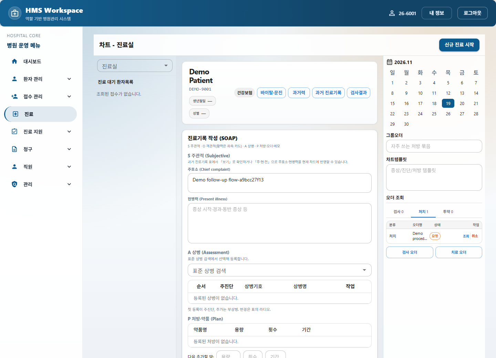
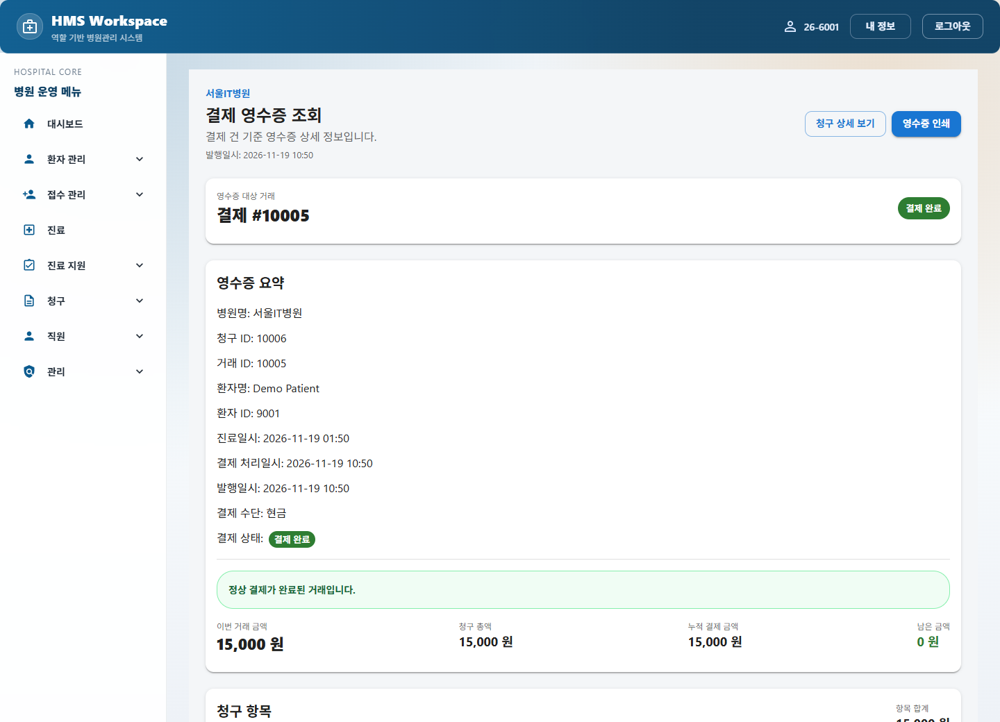
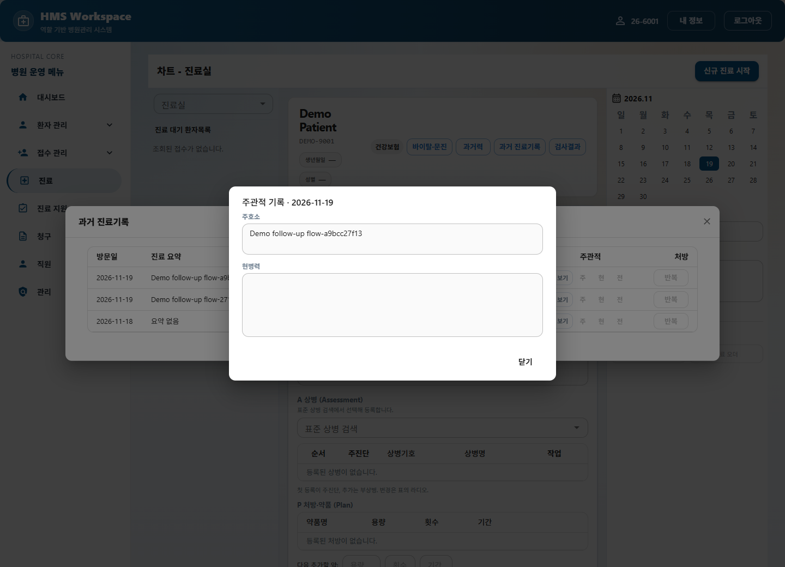
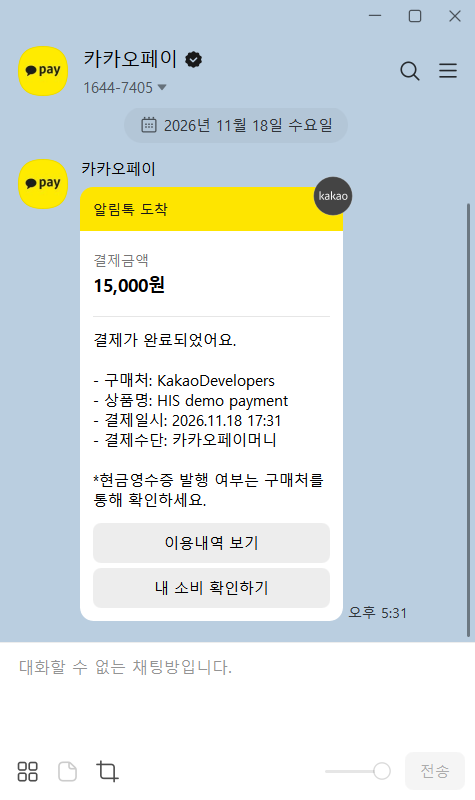

# 병원정보시스템(HIS)

학원 팀 프로젝트를 바탕으로 병원 업무 서비스를 한 번에 실행할 수 있게 정리했습니다. 개인 작업으로 Docker Compose와 Oracle 데모 데이터 복원, 진료 차트 조회, 결제 검증을 정리했고 이 과정에서 Codex를 활용했습니다.

**예약 → 접수 → 진료 → 수납**

## 업무 화면

### 진료 차트



### 현금 수납 영수증



<details>
<summary>진료 완료 후 이력</summary>



</details>

<details>
<summary>카카오페이 테스트 결제 알림</summary>



</details>

## 실행

Git과 Docker Desktop을 설치한 뒤 Windows CMD에서 실행합니다.

```cmd
git clone https://github.com/babo99con/final-his-portfolio.git
cd final-his-portfolio
copy .env.example .env
docker compose up --build -d
```

Oracle 초기 복원이 끝나면 [http://localhost:3001](http://localhost:3001)에서 데모 계정 `26-6001` / `1111`로 로그인합니다.

## 검증 결과

- 빈 Oracle 볼륨에서 가상 데이터 복원과 데모 로그인을 확인했습니다.
- 진료 중 차트를 새로고침해도 환자와 처치 오더가 표시됐고, 진료 완료 후 같은 주소에서 이력을 열었습니다.
- 현금과 카카오페이 테스트 결제에서 각각 15,000원 수납과 잔액 0원을 확인했습니다.

포트, Oracle 복원, 결제 설정, 이미지 배포와 테이블 관계는 [구성과 운영 문서](docs/operations.md)에서 확인할 수 있습니다.
